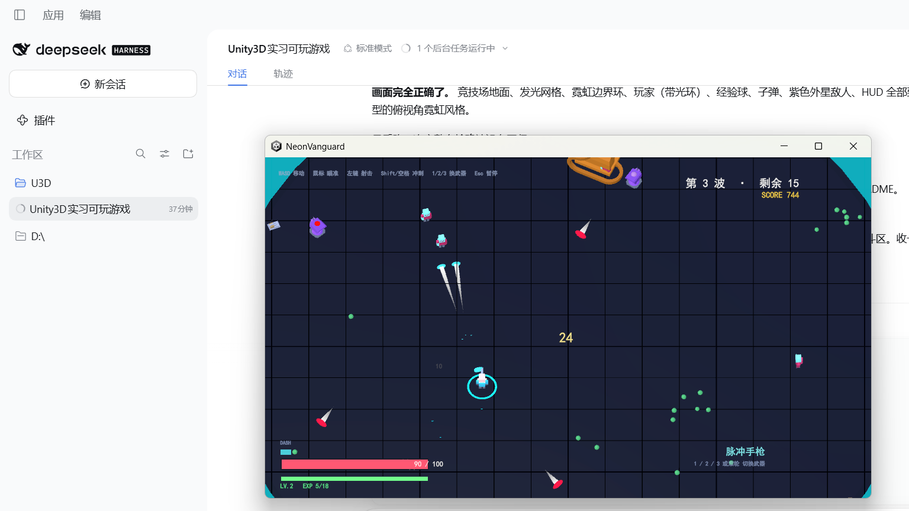

# Neon Vanguard · 霓虹先锋

一个**俯视角波次生存 + 肉鸽升级 + 首领战**的 Unity 3D 小游戏。

面向 Unity 客户端实习求职的作品集项目：**可运行、可讲、代码可读**。



---

## 1. 快速开始

### 方式 A：直接玩
双击 **`Build/Windows/NeonVanguard.exe`**。

### 方式 B：用 Unity 编辑器打开
1. Unity Hub → Add → 选择 `NeonVanguard` 文件夹（本工程基于 **Unity 2022.3.62f3c1**，2022.3.x 均可）
2. 打开后直接按 **Play**
   > 场景文件 `Assets/Scenes/Main.unity` 是**空的**，这是刻意设计：
   > 整个舞台（相机、光照、场地、角色、UI）由 `Bootstrap.cs` 在运行时构建。
3. 想自己出包：菜单 `Neon Vanguard → 构建 Windows 版本`

### 方式 C：命令行无头构建
```bash
Unity.exe -quit -batchmode -nographics -projectPath <工程路径> \
          -executeMethod NeonVanguard.EditorTools.Builder.BuildWindows
```

### 方式 D：无头自动化自检（推荐给面试官）
```bash
Build/Windows/NeonVanguard.exe -batchmode -nographics -logFile out.log -nvt-selftest 180
```
游戏会**自己玩 180 秒**（自动瞄准、走位、冲刺、自动选升级），结束时输出统计报告并用退出码表示结果
（`0` = PASS）。这是本工程的一个亮点：**玩法逻辑有自动化验证，不依赖人工试玩**。

---

## 2. 操作方式

| 操作 | 按键 |
| --- | --- |
| 移动 | `W` `A` `S` `D` |
| 瞄准 | 鼠标 |
| 射击 | 鼠标左键（按住连发） |
| 冲刺（带无敌帧） | `Shift` 或 `空格` |
| 切换武器 | `1` `2` `3` 或鼠标滚轮 |
| 升级选择 | `1` `2` `3` 或鼠标点击卡片，`R` 重抽 |
| 暂停 / 继续 | `Esc` |
| 重开一局 | 暂停中按 `R`，或结算页按 `空格` |
| 返回标题 | 暂停中或结算页按 `Q` / `Esc` |
| **退出游戏** | 暂停中 / 结算页 / 标题页按 `X`（或 Alt+F4） |

**核心循环**：击杀敌人 → 掉落经验 → 升级 → 三选一强化 → 更强的波次 → 每 5 波首领 → 死亡结算并写入最高分。

---

## 3. 玩法内容

### 三把武器（手感差异化明显）
| 武器 | 特点 | 定位 |
| --- | --- | --- |
| **脉冲手枪** | 0.135s 间隔、低伤高频、散布极小 | 通用输出，长按即可 |
| **碎裂霰弹** | 7 发弹丸、26° 大散布、击退极强 | 近身爆发 + 推开包围 |
| **轨道炮** | 46 单发伤害、穿透 6 个目标、带顿帧 | 清直线、点杀精英 |

### 六种敌人 AI
| 敌人 | 行为 |
| --- | --- |
| **追猎者** | 直线追击 + 侧向正弦摆动（成群时不会挤成一条线） |
| **暴君** | 高血高甲、贴近时加速撞击 |
| **织网者** | 维持理想射程、左右横移，**开火前闪烁预警**再射击 |
| **突进者** | 缓慢逼近 → **蓄力预警** → 高速冲锋，专门考验横向走位 |
| **孢裂体** | 本体不强，但**死亡时分裂**成数只小型追猎者，清场必须补刀 |
| **深渊主宰（首领）** | 环形弹幕 / 冲锋撞击 / 召唤小怪 三套技能循环 |

此外从第 6 波起会混入**精英敌人**（体型更大、3.2 倍血量、带琥珀色光环），
制造局部压力峰值，而不是让整波敌人均匀变强。

### 20 张肉鸽强化卡 + 连杀倍率
分普通 / 稀有 / 史诗三档按权重抽取，可叠加、有上限。既包含纯数值强化（伤害、射速、暴击、
护甲、回复），也包含**改变玩法形态**的机制卡（冲刺释放冲击新星、冲刺路径撕裂伤害、
身周灼热力场、子弹爆炸、多重瞬步）。

### 难度曲线
- 每波敌人数量线性增长并**封顶 58**、同屏上限**封顶 36**（性能与体验的双重约束）
- 敌人类型按波次解锁：第 2 波暴君 → 第 3 波远程 → 第 4 波突进者 → 第 5 波孢裂体
- 生命用复合曲线 `1 + (波次-1)*0.17 + 波次^1.35*0.012` 缩放，前期接近线性、后期加速
- 第 6 / 9 波起混入 1~2 只精英
- 每 5 波首领战，且配少量杂兵，制造"边躲首领边清小怪"的复合压力

### HUD（全部带平滑动画）
- **生命条**：三层叠放 —— 主血条（亮红，随掉血**可见地一格一格退下去**）+
  浅色残影（更慢地追上去，把"刚刚掉了多少"标出来）+ 暗红损失层（垫在残影之外）。
  掉血瞬间整条闪白，血量低于 30% 时还会脉动提示
- **经验条**：随经验**变长**（平滑），升级后归零重新增长
- **冲刺条**：消耗的那一刻**立即清空**，然后随冷却从 0 单调涨到满；
  就绪时亮青色并显示「就绪」，充能中为暗蓝
- 连杀计数、波次剩余、分数、当前武器

> 状态条统一走 `Approach(current, target, speed, dt, falling)`：
> **涨一定平滑**（要看得见过程），**降是否平滑由 `falling` 决定** ——
> 血条取 `falling = true`（要看见血退下去），冲刺条取 `false`（用掉那刻必须立刻归零）。
>
> 这三条的数值都有**逐帧采样断言**兜底（见第 6 节 Bug 9），不是"看起来对"就算数。

---

## 4. 工程结构

```
Assets/
├── Editor/
│   └── Builder.cs                 一键 / 命令行构建；自动补齐场景、Build Settings、TMP 资源
├── Resources/
│   ├── Fonts/NotoSansSC-VF.ttf    中文字体（SIL OFL 1.1，允许再分发）
│   ├── Fonts/OFL.txt              字体许可全文
│   └── Models/*.obj,.mtl          Kenney Space Kit 模型（CC0，见 Docs/ART_CREDITS.md）
├── Scripts/
│   ├── Core/
│   │   ├── Bootstrap.cs           场景构建器：相机、光照、竞技场、UI 全部代码生成
│   │   ├── GameManager.cs         流程状态机（标题/战斗/升级/暂停/结算）
│   │   ├── EventBus.cs            事件总线 + 事件定义
│   │   ├── Pool.cs                对象池（子弹每秒上百发，避免 GC 抖动）
│   │   ├── Juice.cs               打击感：屏幕震动、顿帧、闪白、伤害飘字
│   │   ├── AudioKit.cs            程序化音频合成（工程内无任何 .wav）
│   │   ├── AudioKit2.cs           音频播放服务（声道轮转 + 环境垫乐）
│   │   ├── MeshLib.cs             运行时几何 / 材质库
│   │   ├── ModelLibrary.cs        Kenney 模型加载 + 按敌人类型染色（含程序化兜底）
│   │   ├── TextRenderer.cs        中文文字系统（TMP 动态字体 + Legacy 兜底）
│   │   ├── Palette.cs             全局配色
│   │   └── SaveData.cs            存档 + 单局运行时数据
│   ├── Gameplay/
│   │   ├── Player.cs              玩家：移动 / 冲刺 / 三武器 / 受伤 / 相机跟随
│   │   ├── PlayerStats.cs         属性表 + 武器配置表
│   │   ├── Bullet.cs              子弹（SphereCast 连续碰撞检测）+ 轻量特效
│   │   ├── Enemy.cs               敌人（4 种 AI 共享受击 / 死亡逻辑）
│   │   ├── EnemyDef.cs            敌人定义与波次缩放（数据驱动）
│   │   └── XpOrb.cs               经验球磁吸 + 回血包
│   ├── Systems/
│   │   ├── WaveDirector.cs        波次导演：刷怪、同屏上限、首领节奏
│   │   ├── UpgradeLibrary.cs      强化卡定义与稀有度加权抽取
│   │   ├── Arena.cs               竞技场（程序化网格 + 边界夹具 + 场景景观）
│   │   └── SelfTest.cs            无头自动化自检（让游戏自己玩并输出报告）
│   └── UI/
│       ├── HudController.cs       HUD + 标题 / 暂停 / 结算 + 连杀计数
│       └── UpgradePanel.cs        升级三选一
└── TextMesh Pro/                  TMP Essential Resources（构建时自动铺设）
```

---

## 5. 技术点

1. **场景零手工装配**：用 `[RuntimeInitializeOnLoadMethod]` + 代码构建整个舞台。
   没有预制体、没有 GUID 引用断裂、没有二进制资源，code review 与 diff 都干净。
   *取舍见第 7 节 —— 正式项目不该这么做。*
2. **子弹用 SphereCast 做连续碰撞检测**：轨道炮 78 单位/秒，单帧位移超过敌人直径，
   普通 `OnTriggerEnter` 会直接穿模。这里每帧从上一帧位置做扫掠，并用
   `SphereCastNonAlloc` + 组件过滤（不依赖工程里可能不存在的自定义 Layer）保证判定可靠。
3. **对象池**：子弹、火花、飘字全部池化；并处理了"重开一局时飞行中的池化对象残留"这个坑。
4. **打击感工程化**：`Juice.cs` 把屏幕震动、顿帧、命中闪白、伤害飘字、受击缩放做成可复用接口。
   同样的数值，有无反馈的体验差距是数量级的。
5. **帧率无关的平滑**：相机跟随、朝向插值统一用 `1 - exp(-k·dt)` 而非 `Lerp(a, b, 0.1f)`，
   保证 30fps 与 144fps 手感一致。
6. **数据驱动的数值设计**：`PlayerStats` 是唯一数值来源，20 张强化卡只是"配置 + 一次 Apply"，
   加新卡不需要碰任何逻辑代码。
7. **程序化音频合成**：所有音效与背景垫乐由包络 × 振荡器在运行时算出，工程内零音频文件。
8. **自动化集成自检**：`SelfTest.cs` 让游戏自己玩并做断言。
   它在开发过程中真实抓到了 5 个 bug（见第 6 节），这类"跑起来才出现"的问题
   靠静态阅读代码是很难发现的。

---

## 6. 自检实际抓到的 Bug（真实修复记录）

这部分是面试时最有说服力的素材 —— 都是"看代码看不出来、必须跑起来"的问题：

1. **子弹永远打不中**：最初用 `LayerMask.GetMask("Enemy")`，但工程没有配置自定义 Layer，
   该调用返回 `0`，`SphereCast` 掩码为 0 时命中结果恒为空。改为"掩码粗筛 + 组件精确判定"。
2. **重开后残留幽灵子弹**：`Pool.ClearAll()` 只销毁了池根节点，
   没处理仍处于激活状态、正在飞行的池化对象。补了 `FindObjectsOfType<PooledObject>()` 兜底回收。
3. **HUD 订阅被自己清掉**：`BeginRun()` 里 `EventBus.Clear()` 把 HUD 在 `Build()` 时建立的订阅
   一起清空，导致波次计数恒为 0（玩家永远看到"第 1 波"）。
   改为"清空后由 GameManager 统一回调各系统重新订阅"。
4. **相机俯角被每帧拉平**：`Juice.Update` 用**绝对旋转**给相机写震动，
   把 58° 俯角覆盖成 0°，整个场景被挤到画面边缘。
   顺带发现：因为相机 rig 在原点、`basePos` 恒为 0，**屏幕震动此前从未生效**。
   改为以基础位姿做相对偏移叠加。
5. **竞技场地面"消失"**：线性雾的起点(34)小于"相机到场地远端的距离"(约 75)，
   整块地面被刷成雾色；叠加地面用了 `Unlit` 材质，在暗场景里与背景无法区分。
   修正雾距离并把地面换成受光材质。
6. **经验球被过早回收**：回收边界只留 3 单位余量，而敌人常死在场地边缘，
   导致大量经验白白消失、玩家十几分钟升不到 2 级。放宽边界并延长存活时间。
7. **UI 点击全部失灵**：`ProjectSettings/InputManager.asset` 里缺少 UGUI 的
   `Submit` / `Cancel` 两个虚拟按钮。`StandaloneInputModule` 每帧都会读它们，
   缺失就每帧抛 `ArgumentException: Input Button Submit is not setup`，
   后果是 EventSystem 失效、升级卡片点不动（而键盘 1/2/3 仍能用，所以很容易漏掉）。
   已按 Unity 默认配置补全全部 19 条输入轴（含键盘 + 摇杆两套），
   并把「输入轴是否齐全 / EventSystem 是否可用」加入自检断言。
8. **切换界面时上一个界面不消失**：`HudController` 早期只切换了标题页和战斗 HUD，
   **从没关过暂停页与结算页**，导致"死亡后重开"时结算面板叠在标题上、文字互相糊住。
   改为由 `SetScreen(UiScreen)` 统一管理四块整屏界面的互斥可见性，
   并把「任意时刻恰好一块界面可见」做成自检断言（会依次走
   战斗中 → 暂停 → 继续 → 死亡结算 → 重开 → 返回标题 六步逐项校验）。
9. **状态条"看起来没动"**（两个并存的缺陷）：
   - **血条图层顺序反了**：把"已损失"红条最后创建，于是它盖在最上层，
     主血条变短的过程被完全遮住。修正为 主血条 → 残影 → 损失层 的创建顺序。
   - **冲刺条方向与冷却相反**：`DashCooldownNormalized` 写成了 `1 - timer/cd`，
     而 `timer` 的语义是"已经充了多久"，于是满充能时算出 0、刚用掉反而算出 1。
     改为 `timer / cd`。
   - 附带修正：`Approach()` 早期对"下降"一律瞬时吸附，把血条的下降动画也吃掉了。

   这两个缺陷都是**肉眼读代码判断不出来**的，最后是靠自检里的**逐帧采样断言**定位：
   受伤后每 0.12s 采一次血条/残影，消耗冲刺后每 0.12s 采一次冷却条，
   再断言"血条在下降且残影滞后"、"冲刺消耗即归零且单调回升到满"。

9. **状态条"完全不显示变化"（根因：`Image` 在无 sprite 时忽略 `fillAmount`）**
   这是整个项目里最难查的一个 bug，因为**所有数值都是对的**：
   Inspector 里 `fillAmount` 确实在 0→1 之间变，但画面宽度纹丝不动。

   实测证据（自检打印）：
   ```
   XpFill: type=Filled  sprite=null  fill=0.167   尺寸=396x10
   经验条 实测渲染宽度 = 253 / 253          ← fillAmount = 0.167 却画成满宽
   ```

   根因：Unity 的 `Image` 只有在**有 sprite** 时才会走"填充"分支；
   `sprite == null` 时无论 `type` 是不是 `Filled`，都直接画满整块矩形。

   修复：**不再用 `Image`**，改成自绘 `MaskableGraphic` 子类 `BarGraphic`：
   - 在 `OnPopulateMesh` 里按 `fillAmount` 生成四边形（左端固定，右端 = 宽度 × 比例）；
   - `fillAmount` 做成属性，赋值时 `SetVerticesDirty()` 触发重绘；
   - `fillAmount = 0` 时直接产出空网格。
   这样完全不依赖 sprite 资源，也不受 `Image` 内部实现影响。

   同批修掉的另外两个相关问题：
   - **图层顺序**：把"已损失量"红条最后创建 → 它盖在最上层，主血条变短的过程被遮住。
     改为 损失层 → 残影 → 主血条。
   - **下降动画过慢**：`HpLerpSpeed = 2.6` 时掉 80% 血要 1.5 秒才走完，观感像"条没动"。
     提高到 8（约 0.3 秒落定），残影保持更慢（2.2）以保留"刚掉了多少"的对比。

   **验证方式也一起升级了**：因为像素坐标受布局常量、`CanvasScaler` 匹配模式、
   分辨率三重影响（前后猜错三次），最终改为让自检**直接生成
   `bar_hp100 / bar_hp55 / bar_hp20` 三张截图**，用肉眼对比长度 —— 这是最不容易自欺的验证。

---

## 7. 已知取舍

- **"全代码构建"是作品集取向，不是产品取向。** 正式项目应改为
  `Prefab + ScriptableObject 配置 + Addressables`，否则美术与策划无法参与协作。
  工程已为此预留退路：美术资源走 `ModelLibrary` 统一加载，**取不到模型时自动回落到程序化几何体**。
- **敌人避障是简单转向 + 刚体推挤**，数量很大时会重叠；产品化应换流场（flow field）寻路。
- **音效为程序化合成**，风格统一但表现力有限，正式项目应换录制素材。
- **尚无手柄支持**（当前用 Legacy Input Manager，可平滑迁移到新 Input System）。
  *注意：`InputManager.asset` 里已包含摇杆轴定义，但游戏逻辑只读键鼠。*
- **TMP 的 Essential Resources 需要构建脚本自动铺设**：批处理模式下
  `AssetDatabase.ImportPackage` 不会落地文件，因此构建脚本改为直接解包其 `.unitypackage`。
- **场地内装饰道具用固定随机种子**生成，因此每次运行布局一致；
  目前道具只做了"避开中心 20 单位"的简单约束，偶尔会有几件挤在一起。

---

## 8. 资源与授权

| 内容 | 授权 | 说明 |
| --- | --- | --- |
| 代码（`Assets/Scripts`、`Assets/Editor`） | **MIT** | 见 [`LICENSE`](LICENSE) |
| 美术（`Assets/Resources/Models`） | **CC0 1.0** | Kenney Space Kit 2.0，见 [`Docs/ART_CREDITS.md`](Docs/ART_CREDITS.md) |
| 字体（`Assets/Resources/Fonts`） | **SIL OFL 1.1** | Noto Sans SC，见 [`Assets/Resources/Fonts/OFL.txt`](Assets/Resources/Fonts/OFL.txt) |
| 音频 | 无外部资源 | 音效与背景垫乐全部由代码在运行时合成 |

几点说明：

- 字体选 Noto Sans SC 而非系统黑体，是因为 OFL **明确允许随软件打包再分发**，
  而 Windows 自带字体不允许随工程分发。
- 代码里保留了三级字体回退（工程字体 → 系统字体 → Unity 内建字体），
  即使删掉字体文件，游戏依然能跑（只是中文可能退化）。
- 美术资源同样是可插拔的：`ModelLibrary` 取不到模型时会自动回落到程序化几何体。

---

## 9. 文档

- [`Docs/面试与简历材料.md`](Docs/面试与简历材料.md) —— 简历条目写法、高频追问与回答要点、演示建议
- [`Docs/ART_CREDITS.md`](Docs/ART_CREDITS.md) —— 美术资源来源、授权、材质处理说明
